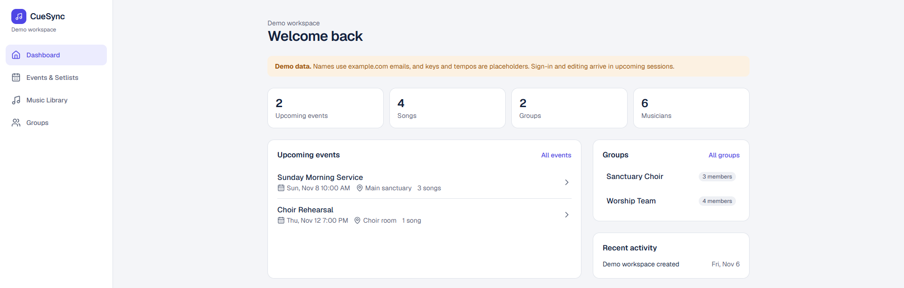

# CueSync

**Music coordination for worship leaders, band leaders, choir directors, and ensemble managers.**

Music leaders spend hours every week repeating the same work: finding the right version of a song, building the setlist, figuring out who needs which recording, and retyping the same details into texts and emails for each group. CueSync lets a leader enter that information once and reuse it everywhere.

**Core workflow:** Organize the event → Assemble the band → Build the setlist → Draft each group's message → Send it on the platform your band already uses.

### [▶ Try it live: cue-sync.vercel.app](https://cue-sync.vercel.app)

> **Status:** Active development. The live site is a read-only demo with clearly labeled sample data. Sign-in and editing are next. See the [roadmap](#roadmap) and [session log](docs/session-log.md).



---

## Features (planned and in progress)

| Area | What it does | Status |
|---|---|---|
| Data model | Workspaces, groups, contacts, songs, events, setlists, messages, audit log | Done |
| Events & setlists | View events and ordered setlists (done); create and edit (next) | Read-only done |
| Music library | Saved songs with links to recordings, charts, and authorized lyrics sources | Read-only done |
| Groups | Musicians in many groups (Worship Team, Choir, Live Band) without duplicate contacts | Read-only done |
| Sign-in & roles | Owner, leader, and musician roles per workspace | Next |
| Show checklist | A to-do list for every event, from assembling the band to the show, with due dates planned backward from show day | Planned |
| Message builder | Drafts a tailored message per group, formatted for the platform the leader picks (email, text, WhatsApp, GroupMe, Slack). The leader copies it and sends it from their own app. | Planned |
| Music research | Search for songs and recordings with source attribution | Planned |
| Deployment | Live on Vercel with a hosted Prisma Postgres database | Done |

A clickable UI prototype lives in [`docs/prototype/cuesync.html`](docs/prototype/cuesync.html). Download it and open it in a browser to see the full intended workflow.

## Security by design

CueSync stores contact information for real people, so security is built into the foundation, not added later.

- **Workspace isolation.** Every workspace-owned table carries a required `workspaceId`. Join tables use composite foreign keys `(workspaceId, id)`, so the **database itself** refuses to link a group in one workspace to a contact in another. This blocks a whole class of cross-tenant bugs (IDOR) even if application code makes a mistake.
- **Server-side authorization.** Every read and write goes through one helper that checks the user's membership and role. Hiding a button is not authorization.
- **Input validation.** All input is validated with Zod on the server, even when the browser already validated it.
- **Secrets stay on the server.** API keys live in environment files that are never committed. [`.env.example`](.env.example) holds placeholders only.
- **Honest statuses.** A message is marked `sent` only after a provider confirms it. Copying text or opening an email app is never reported as sent.
- **Human approval.** AI drafts messages, but nothing is sent without explicit confirmation from the leader.
- **Audit trail.** Important actions are recorded in an `AuditLog` table.
- **Copyright-aware.** CueSync stores links to authorized lyrics sources, not copyrighted lyrics text.

The full rule set that guides development is in [`CLAUDE.md`](CLAUDE.md).

## Tech stack

- **Next.js** (App Router), **React**, **TypeScript** (strict mode)
- **Tailwind CSS** and **shadcn/ui**
- **PostgreSQL** with **Prisma ORM** (migrations committed to git)
- **Zod** for validation; **Vitest** and **Playwright** for testing (being added)

## Getting started

**Prerequisites:** Node.js 20+ and Git. No Docker needed; Prisma runs a local Postgres for development.

```bash
git clone https://github.com/athomas-ui/CueSync.git
cd CueSync
npm install
cp .env.example .env          # then fill in the values from `npx prisma dev ls`
npx prisma dev --name cuesync --detach   # first time only: creates the local database
npm run db:migrate            # create the tables
npm run db:seed               # load clearly labeled demo data
npm run dev                   # open http://localhost:3000
```

| Command | What it does |
|---|---|
| `npm run dev` | Start the development server |
| `npm run lint` | Lint the code |
| `npm run typecheck` | Type check without building |
| `npm run db:start` / `db:stop` | Start or stop the local database |
| `npm run db:migrate` | Apply database migrations |
| `npm run db:seed` | Load demo data |
| `npm run db:inspect` | Print a read-only summary of the demo data |
| `npm run db:studio` | Browse the database in Prisma Studio |

## Deployment

Hosted on **Vercel** with **Prisma Postgres**. Every push to `main` deploys automatically. Database migrations are applied by hand with `prisma migrate deploy`, never during the build. See the [deployment runbook](docs/deployment.md).

## Roadmap

1. **Foundation:** data model, demo data, read-only pages *(done)*
2. **Deployment:** live on Vercel with hosted Postgres, zero npm audit findings *(done)*
3. **Sign-in and authorization:** accounts, a private workspace per user, workspace isolation tests *(next)*
4. **Create and edit:** events, setlists, groups, members, library
5. **Show checklist:** phase templates per event type, due dates planned backward from show day
6. **Message builder:** platform-aware drafts, edit, copy or open in app, mark as sent
7. **Music research and AI drafts:** search with source attribution, optional AI writing

## About

Built by **Andrew Thomas** as part of the i.c.stars program, while transitioning from program management into technology and cybersecurity. CueSync combines two things I know well: coordinating people and making music.
